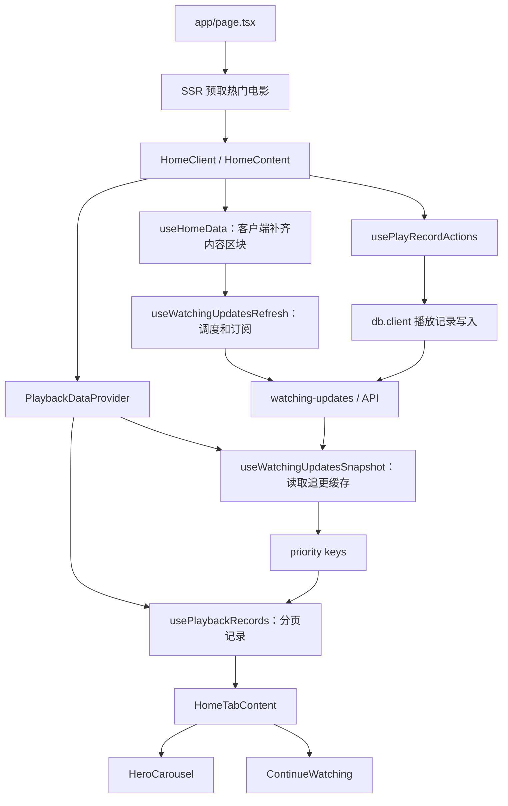

# 首页继续观看数据层重构实施方案

日期：2026-11-15。代码分析基线：`1d27e82`。

状态：待实施。本轮仅阅读代码、运行现有定向测试并编写本方案，未修改业务代码。

## 1. 目标与已确定的取舍

承接前一轮“继续观看两层重写”的讨论，本次范围是首页播放记录链路及其共享客户端存储，不重写整个首页。实施目标：

1. 首屏快速展示最近记录，不等待追更网络请求。
2. 追更结果到达后，仅补齐尚未加载的必要记录，不 replace 首屏，不丢已追加的页面。
3. 删除同步从 UI 移除；过时读取不能恢复已删除记录。
4. 删除或清空请求失败时，根据成功读取的权威快照处理；读也失败时明确“未确认”，不伪造服务器真值。
5. 播放页续播、UserMenu、收藏页数据补全、统计页事件契约保持兼容。
6. 降低跨层协调复杂度，以可验证的不变量为依据，不以 ref 数量或代码行数作为完成指标。

本方案固定采用以下决策，实施者不需要重新发散选型：

| 事项         | 本轮选择                                                                     | 原因                                         |
| ------------ | ---------------------------------------------------------------------------- | -------------------------------------------- |
| 首屏         | 保留 idle 调度；发出时读取最新 desired keys                                  | 不等待追更，利用 idle 期间已经到达的快照     |
| 补拉         | 现有 `getPlayRecordsPage({ includeKeys, pageSize: 1 })`，只合并所请求的 keys | 不修改服务端协议；明确仍可能附带一条普通记录 |
| 页面读取并发 | 同一 hook 会话最多一个有效页面读取，首拉先于补拉                             | 直接消除首拉 replace 与补拉 merge 的竞争     |
| append       | 保留首屏建立的固定 includeKeys 基线                                          | 现有分页会从普通分页候选中排除 includeKeys   |
| 变更串行化   | db 层每用户一个队列，覆盖预读、写入、补偿                                    | 保持既有竞态约束                             |
| 失败补偿     | db 层执行一次完整权威读取；hook 消费结果                                     | 避免 db 全量 reconcile 后 hook 再做一次 GET  |
| 追更系统     | 保留现有 snapshot / refresh hooks                                            | 与播放列表分页职责不同，不合成巨型 hook      |
| 缓存         | 完整快照与 cold 严格区分，保留 5 分钟有效期                                  | 防止部分分页覆盖全量读语义                   |
| 依赖与服务端 | 不新增状态管理库，不修改服务端存储或 API 协议                                | 控制本轮范围                                 |

“小补拉”在本轮只表示响应附带的数据量减少，不表示服务端执行按 key 的数据库查询。真正的 keys-only endpoint 和存储层点查优化作为后续独立任务。

## 2. 当前首页代码与真实调用链

以下路径均相对于仓库根目录，行号为分析基线，实施时按符号再次定位。

### 2.1 三条数据流



| 文件 / 入口                                  | 当前职责与重构关联                                                                    |
| -------------------------------------------- | ------------------------------------------------------------------------------------- |
| `src/app/page.tsx:10`                        | 有 cookie 时尝试 SSR 初始数据，异常降级为空快照                                       |
| `src/lib/home-data.server.ts:92`             | SSR 只预取热门电影；进程内缓存 60 秒、在飞请求去重                                    |
| `src/hooks/useHomeData.ts`                   | 客户端只补缺失的电影、剧集、综艺、新番；有分项重试、取消和 generation                 |
| `src/hooks/useWatchingUpdatesRefresh.ts:118` | 追更初次检查按至少 4 秒延迟配置进入 idle 调度；订阅失效和正常事件                     |
| `src/hooks/useWatchingUpdatesSnapshot.ts`    | 同步读缓存、更新 React 快照；本身不执行追更网络拉取                                   |
| `src/contexts/PlayPageContext.tsx:78`        | 将路由 include keys 与 `hasNewEpisode` 的追更 keys 取并集，传给分页 hook              |
| `src/hooks/usePlaybackRecords.ts`            | 首屏、priority 重拉、append、游标、删除保护、清空会话失效混在一起                     |
| `src/hooks/usePlayRecordActions.ts`          | 乐观删除、失败本地回滚、重复操作去重和清空协调                                        |
| `src/components/HomeClient.tsx:98`           | 把 context 与动作 hook 接成 `HomeContinueWatchingState`                               |
| `src/components/HomeTabContent.tsx:89`       | 从记录中选最新一条作为 Hero 第一帧；Hero loading 也依赖继续观看 loading               |
| `src/components/ContinueWatching.tsx:165`    | initial/refresh 错误走 onRetry；append 错误通过 onLoadMore 重试；空数据且无错误时隐藏 |
| `src/lib/continue-watching-display.ts`       | 负责排序、徽标、进度展示，消费追更快照；本轮不改排序规则                              |

调度时间不是严格墙钟时间：`scheduleIdleTask` 在支持 requestIdleCallback 的浏览器中先等待 idle 回调，再执行 delayMs 对应的 setTimeout。不要写成“挂载后恰好 200ms / 4s 发请求”的验收条件。

### 2.2 重复请求的条件

首页播放记录首拉的 delayMs 为 200；追更检查在另一条较晚的调度链中运行。

追更快照到达 → Provider 算出不同 keys → 旧分页 hook 发现 signature 变化：

- 首屏尚未完成：再发 replace，使原首屏响应失效。
- 已有记录：发 priority 请求，但仍请求普通页 + includeKeys。
- 仅删除一个 key 造成集合缩小，也被视为需要 priority 刷新。

因此冷缓存下很容易出现重复请求，但并非所有首页加载必定两次：热追更缓存、集合未变化或无追更 key 时可以只有一次。测试应覆盖具体触发条件，不使用“每次必两次”作为事实前提。

### 2.3 删除后的事件链

```text
ContinueWatching → 上层 onDelete → usePlayRecordActions
  → 同步移除 + markPlayRecordDeleted
  → db.deletePlayRecord（每用户串行）
  → 成功后 invalidateWatchingUpdatesClientCache
  → watchingUpdatesChanged(invalidated=true)
  → useWatchingUpdatesRefresh 执行检查
  → 正常追更事件更新 snapshot
  → priority keys 改变
  → 旧分页 hook 再请求
```

db 层失败时已经尝试 reconcile，但动作 hook 又使用删除前的本地记录回滚并撤销 shield；两层没有共享补偿结果。

`VideoCard.tsx:543` 在提供 onDelete 时调用上层回调并返回，不会再自行调用 db 删除。此次重点是上下层补偿不一致，不是 VideoCard 双发 DELETE。

### 2.4 共享消费者

- 播放页 `src/app/play/page.tsx:122` 只读取 playRecords；Provider 的 include keys 来自路由，需支持挂载后变化。
- `usePlayProgress` 传给 savePlayRecord 的 existingRecords 是分页结果，不能当作完整用户数据。
- UserMenu 打开时调用 getAllPlayRecords，收到 playRecordsUpdated 后也重新读取；因此事件还可能触发后台同步。
- `useFavoriteItems` 在收藏数据到达后延迟读取 getAllPlayRecords，用于补全展示字段；首页收藏 tab 也属于回归范围。
- play-stats 监听 playRecordsUpdated 并触发追更刷新。事件名、完整快照 detail 均需保留，即使当前某些监听者不读取 detail。
- 播放卸载路径的 sendBeacon/keepalive 直接调用服务端，不受客户端 store 队列控制；本轮不承诺跨标签页、跨设备或卸载请求的线性一致性。

## 3. 修改边界与文件清单

### 3.1 必须兼容

- `getPlayRecordsPage`、`getAllPlayRecords`、`savePlayRecord`、`deletePlayRecord`、`clearAllPlayRecords` 的公共参数与 Promise 返回类型。
- savePlayRecord 的 original_episodes 处理、追更失效条件和服务端 ignored 语义。
- `PlaybackDataProvider`、`usePlaybackData` 名称及 includePlayRecordKeys 的动态语义。
- `ContinueWatching` / `HomeTabContent` props、展示逻辑及现有测试断言。
- favorites / search-history / skip-configs / user-stats 缓存行为及 cacheManager 实例。
- `playRecordsUpdated` 事件名、完整快照 detail、用户隔离。
- localStorage 模式的原存储 key 与持久化格式；SSR 安全行为。
- 缓存维护的桶文件导出名称。

### 3.2 计划变更

| 文件                                                        | 操作                                                                            |
| ----------------------------------------------------------- | ------------------------------------------------------------------------------- |
| `src/lib/db.client/play-records/store.ts`                   | 新建：每用户完整缓存、revision、串行队列、读取去重及有效性判断                  |
| `src/lib/db.client/play-records/api.ts`                     | 新建：五个公共 API、原业务规则、内部权威读取及补偿错误结果                      |
| `src/lib/db.client/play-records/events.ts`                  | 新建：事件派发与用户检查；不强制再造通用订阅框架                                |
| `src/lib/db.client/play-records.ts`                         | 迁移期作为旧路径兼容转发层；最终是否删除以全部引用迁移为准                      |
| `src/lib/db.client/cache-manager.ts`                        | 移除播放记录专属状态，缓存维护方法转接新 store；保留其他领域                    |
| `src/lib/db.client/core.ts`                                 | 播放记录失败分支接入新补偿入口，避免形成顶层模块循环或二次补偿                  |
| `src/lib/db.client.ts`                                      | 更新导出路径，公共导出保持兼容                                                  |
| `src/hooks/useContinueWatchingData.ts`                      | 新建：分页视图 + 删除/清空动作；输入 desired keys，返回现有播放字段及动作       |
| `src/contexts/PlayPageContext.tsx`                          | 保留追更 hooks 和 keys 合并；接新 hook；移除 setter/mark 接口，暴露动作         |
| `src/components/HomeClient.tsx`                             | 去掉 usePlayRecordActions，直接接 context 动作；继续观看 loading 由记录加载决定 |
| `src/components/ContinueWatching.tsx`、`HomeTabContent.tsx` | 仅调整 PlayRecordsLoadError 的 type import 路径                                 |
| 相关测试                                                    | 新 hook、db 竞态、Provider、真实事件联动集成测试                                |

旧 usePlaybackRecords、usePlayRecordActions 及对应测试在替代完成、测试约束映射后移除，不在第一步删除。不得同时保留两套会执行的生产实现。

不修改 SSR 首页、useHomeData、内容 loaders、HeroCarousel、播放器行为、收藏功能、服务端追更计算、数据库 schema、根构建配置与依赖。发现这些区域的问题记录为后续任务。

工作树分析时已有 `.husky/commit-msg`、`.husky/post-merge`、`.husky/pre-commit` 修改，实施者必须保留，不纳入重构提交。

文档完成检查时还观察到 `src/app/play/utils/danmakuRuntime.ts`、`danmakuRuntime.test.ts`、`danmuCache.ts` 出现并行修改；这些不是本次方案工作产生的改动，同样保留，实施前重新检查工作树。

## 4. db.client 存储层设计

### 4.1 状态与依赖方向

每用户一个 store；只保留一个用户 Map，不再用多个平行 Map 分别管理计数和队列。

建议逻辑状态如下，不要求机械照搬类型名称：

```ts
type FullSnapshot = {
  data: Record<string, PlayRecord>;
  expiresAt: number;
};

type PlayRecordsStore = {
  username: string | null;
  revision: number;
  snapshot: FullSnapshot | null; // null 为 cold，分页结果永不写到这里
  queueTail: Promise<void>;
  pendingMutations: number; // 包含已经入队但尚未执行的写任务
  readInFlight: {
    revision: number;
    promise: Promise<unknown>; // 实现时改为具体快照结果类型
  } | null;
};
```

完整性与新鲜度分开处理：有完整快照但 TTL 已过期，不等于数据是部分结果；是否允许对外缓存命中由 expiresAt 判断。补偿失败时必须失效，不能继续把乐观快照当有效结果。

store 不 import cache-manager，不做 HTTP，不处理 React。身份读取可直接复用 auth 工具，避免 store 依赖 cacheManager。api 使用 store + core HTTP + events。

core 的兼容失败分支若需调用 api 的 reconcile，采用函数内动态 import，且 CRUD 已处理过的失败不得再进入此分支。不要扩大 core 顶层循环依赖。

### 4.2 必须维持的不变量

1. 同一用户所有写操作按调用入队顺序执行，队列失败后仍可继续。
2. 预读 existing record、prepare、乐观写、HTTP、失败/ignored 补偿全部在同一写任务中。
3. 写任务入队时同步注册 pending 并使已发起的普通快照读取失效；任务结束 finally 再推进 revision 并注销 pending。
4. 普通 GET 提交要求：发起时记录的 revision 仍相同、没有 pending 写、身份仍匹配。
5. 请求的去重范围包含用户和 revision，不能把旧 revision 的在飞 Promise 当作新 revision 的刷新结果复用。
6. 全量比较应与提交时当前快照比较，不与请求发起时捕获的旧快照比较；相同结果可更新有效期，但不重复派发事件。
7. cold 下 delete / save 不把 `{}` 或调用方 existingRecords 升级为全量缓存，也不派发伪完整快照。
8. 有完整快照时使用不可变更新；事件发出的快照对象以后不原地修改。
9. clear 成功可以确认完整空快照；clear 失败且补偿也失败必须失效。
10. 切换用户后的排队写在发请求前取消；每个 await 后、提交缓存前、派发事件前都复核身份。清缓存必须使在飞读取失效，不能仅删除数据对象。

pending 登记采用“含排队任务”的口径，因此不能简单要求补偿提交时 pending=1。写任务内的权威补偿具有队列独占执行权，使用独立的补偿提交路径；已排队的后续写不阻止它建立后续写所需的基线，但不得允许队列外普通 GET 借此绕过门禁。

### 4.3 读取规则

`getAllPlayRecords`：

- SSR 返回 `{}`，localStorage 模式读取原存储 key。
- 有有效完整缓存时先返回缓存；无 pending 写时发起按用户/revision 去重的后台刷新。
- 有 pending 写时，不由乐观事件再触发一轮后台刷新；完整缓存可供乐观展示。
- cold 且存在 pending 写时，外部读取等待已排队写完成后重新判断；没有可靠快照时再发普通 GET。
- 写任务内部的 save 预读禁止调用“等待 queueTail 的 getAllPlayRecords”，否则会等待自己。内部预读使用直接、可抛错的权威读取。
- 公共 getAllPlayRecords 保留现有异常兼容行为；内部权威读取必须抛错，禁止把 public API 降级返回的 `{}` 当作服务器确认空数据。
- 因 revision/用户变化失效的响应不写缓存；身份已变时不把旧用户数据作为返回值交给新用户消费者。

`getPlayRecordsPage`：

- 保留参数、URL 编码、响应结构和错误 rethrow。
- 服务端模式直连，localStorage 模式使用 paginatePlayRecords。
- 分页响应不写全量 store、不派发 playRecordsUpdated。
- hook 自己校验页面读取的会话和用户；不要把页面请求偷偷改成 getAllPlayRecords 的缓存切片。

### 4.4 保存、删除、清空

保存原业务函数迁移时不重写算法。完整 store → 调用方 existingRecords → 内部权威预读，作为 existing record 的来源顺序；提供了 existingRecords 时保留原兼容行为，不能把部分数据当全量。

save 返回 ignored 时，队列内执行一次权威补偿，不能先广播未经证实的本地旧值。若该补偿失败，失效缓存。保持当前 ignored 分支的 resolve 兼容语义，避免把“服务端忽略过时保存”改成普通写入失败；为此保留对应测试。

delete / clear 的网络错误在队列内执行一次完整 GET 补偿，然后仍然 reject 原写操作。即使补偿成功，也不把原写失败静默改成成功。错误中携带内部补偿结果供 hook 判断 UI。

localStorage 模式也经同一用户/模式的写顺序控制，避免并发 read-modify-write 丢更新；权威数据源是 localStorage 本身。该模式失败后不请求服务器。

### 4.5 单一补偿所有者与内部结果

新增内部 `PlayRecordsMutationError` 或等价结构化错误，保留公共 `Promise<void>` 签名。仅供新 hook 和测试使用，不作为新增产品公共 API：

```ts
type ReconciliationResult =
  | {
      kind: 'confirmed';
      username: string | null;
      revision: number;
      records: Record<string, PlayRecord>;
    }
  | { kind: 'unconfirmed' }
  | { kind: 'cancelled' }; // 用户切换等，不对新身份恢复旧数据
```

confirmed 是成功读取并完成提交的权威快照，其 token 必须代表该写任务结算后的版本。hook 消费前检查会话、身份、对应动作 token，必要时验证 store 版本；若已被后续写覆盖，不能把旧 receipt 当当前全量状态。

为避免实现任意的跨版本合并：receipt 已失效时按 unconfirmed 处理，提供 retry；不自动循环补偿。不同 key 的并发删除各自有动作 token，不能仅用一个全局“最新删除版本”让其中一个结果静默丢失。

手工 retry 使用内部可抛错的 authoritative reconcile 入口，排到写队列后执行；它不再次发送 DELETE。写任务内补偿使用同一底层读取逻辑，但不能再次入队等待自己。

只有在 mutation 失败或用户显式 retry 时走此完整读取。成功删除的冷缓存路径不得为了补偿框架平白增加全量 GET。

### 4.6 缓存维护接线

逐一处理以下入口及类方法调用者，不能只迁移 CRUD：

- `forceRefreshPlayRecordsCache`：使新 store 快照过期并推进 revision，阻止旧读取重新缓存。
- `refreshAllCache`：播放记录走新权威刷新与提交门禁，其他领域沿用现有行为。
- `getCacheStatus`：从新 store 判断有效完整缓存。
- `preloadUserData`：沿用聚合逻辑，不能继续查看旧字段。
- `clearUserCache` 与 `cacheManager.clearUserCache(username)`：播放记录部分失效新 store；覆盖 user-stats 里的类方法调用。不可顺手重构其他缓存清理行为。
- `handleDatabaseOperationFailure('playRecords')`：委托统一补偿，不再保留旧 cacheManager 的播放记录调用。
- 清理 UserCacheStore 的 playRecords 字段、旧 3 个 Map、播放专属 TTL 分支和自由函数；其他缓存实现保持原样。

## 5. React 数据层设计

### 5.1 保留职责分界

新 `useContinueWatchingData(desiredKeys)` 替代旧 usePlaybackRecords + usePlayRecordActions，只负责播放列表和动作。

Provider 继续调用 useWatchingUpdatesSnapshot，继续合并路由 keys 与追更 keys；useWatchingUpdatesRefresh 继续由 useHomeData 调度。本轮不把追更网络逻辑搬进新 hook。

context 保留原播放数据字段命名，新增 deleteRecord / clearAll，移除 setPlayRecords / markPlayRecordDeleted / markAllPlayRecordsDeleted。HomeClient 做现有 props 的接线，不新增 props。

继续观看与 Hero 的骨架 loading 仅由播放首屏加载决定。追更补齐不把 loading 重新置 true；loadingWatchingUpdates 可保留给其他消费者，但不再让追更快照影响已经可用的卡片和 Hero。

### 5.2 最小状态模型

视图数据可放一个 state：records（null 表示未成功加载）、cursor、固定 baseIncludeKeys、hasMore、loading、loadingMore、loadError。

必要的操作状态：

- generation：清空、卸载、身份失效时递增，所有页面及动作结果都携带会话 token。
- 一个 activeRead：同一会话仅一个有效页面请求，记录类型和 Promise 身份；旧 finally 不得清掉新请求。
- 删除操作按 key 去重，记录 pending / confirmed / unconfirmed 的 shield 与动作 token。
- 一个 clear 状态：pending、unknown 或 idle，以及共享 Promise。
- 当前 desired keys 和补拉防抖句柄。
- 已成功查询但不存在的 keys；失败的补拉 keys；它们用于避免自动循环及定向 retry。
- 对应 retry 的具体原因，公开仍映射为 initial / refresh / append。

这些状态都有不同语义，不强求合并成一个计数器。不要重新引入通用任务框架、任意优先级队列或新的全局状态库。

同步更新 shield、请求占位和必要 ref，再提交 React state，防止同一 tick 的重复操作绕过保护。React state updater 内不要发网络、派事件或修改独立外部状态。

### 5.3 首拉

1. 使用 scheduleIdleTask，保留 delayMs=200 / timeoutMs=1000 配置；cleanup 取消调度。
2. 发出时读取最新 desired keys，规范化去重；pageSize 使用现有 `HOME_RENDER_LIMITS.CONTINUE_WATCHING_PAGE`（12）。
3. 请求在飞期间 keys 变化只更新需求，不再发第二个首屏，也不提前执行补拉。
4. 结果通过 generation、身份、请求身份检查，再过滤 shields，建立记录、cursor、hasMore 和固定 baseIncludeKeys。
5. 首拉完成后按最新需求重新计算 missing；需要时调度一次补拉。
6. 首拉失败设 initial，停止自动补拉；retry 重试首拉，并使用最新 desired keys。
7. StrictMode 第一轮调度取消；卸载后旧响应、catch 和 finally 均不得提交 UI。

### 5.4 增量补拉

定义：

```text
desiredKeys = normalize(routeIncludeKeys ∪ hasNewEpisodeKeys)
missing = desiredKeys
          − loadedKeys
          − shieldedKeys
          − 当前有效查询中已覆盖的 keys
          − 本次持续需求内已经确认不存在的 keys
          − 等待手工重试的失败 keys
```

执行规则：

1. 集合为空直接结束；不因 keys 缩小本身新增请求，之前已经需要的补齐工作仍按最新 missing 判断。
2. 防抖 300ms；真正执行时重新计算，而不是使用 300ms 前捕获的集合。
3. 首拉、append 或另一补拉在飞时记住最新需求，等待当前读取完成后重新计算。
4. 发 `getPlayRecordsPage({ includeKeys: missing, pageSize: 1 })`，从响应中只挑出本次请求的 keys。
5. 提交时再过滤 shield；对已经由动作补偿等更新的同 key，不允许旧查询直接覆盖。默认仅填补当前仍缺失的记录。
6. 不修改 cursor、hasMore、baseIncludeKeys，不触发全量事件，不修改首屏 loading。
7. 成功返回但 key 不存在：记为已确认缺失，当前持续需求内不再自动补拉。key 离开 desired 后可清除此标记，重新进入时重新查询；显式 retry 可重新查询。
8. 失败：保留已有数据与游标，记录失败集合并设 refresh，停止自动循环。retry 时只重试仍需要的失败 keys。
9. 不以 records 整体变化无条件触发 GET，避免“合并 → effect → 同一缺失 key 再请求”的循环。

对于同一批稳定 keys，任意次快照事件或 React rerender 只能产生一次有效补拉；连续新增 keys 在 debounce 内合并，前一请求已经发出后的新增 keys 可以形成下一次补拉。

### 5.5 append

1. 同步占位并返回共享 Promise，避免 loading state 尚未 commit 时重复请求。
2. 初始页未成功、clear pending/unknown、没有 cursor/hasMore 时不发。
3. 若其他页面读取在飞，等待其完成后重新检查状态和 cursor；同一待执行 append 仍去重。
4. 传 cursor、pageSize=12、首屏固定的 baseIncludeKeys。
5. 过滤 shield，按 key 合并；对于已存在记录保留当前值，避免追加页中的重复项回退较新的本地值。
6. 成功推进 cursor/hasMore；失败保留原 cursor，设 append，下一次 onLoadMore 重试同一页。
7. 后补 priority keys 不加入 baseIncludeKeys，不改变已建立的分页基线。它们可能随后出现在普通页，按 key 去重即可。
8. 整页均为重复记录时仍按服务器 cursor 前进，不自动无限连翻；必须有测试验证下一次能继续前进。

### 5.6 删除

1. 先 parseStorageKey；非法 key 不移除 UI、不注册 shield，不请求服务器，走现有错误通知。
2. 同 key pending 删除共享 Promise；不同 key 独立同步移除。
3. 在任何 await 之前注册 shield 和动作 token，然后从 UI 移除该记录。
4. 调用公共 db.deletePlayRecord；db 层负责排队与可能的补偿。
5. 成功：保持本会话 shield，防止较早发出的页面响应带回记录。不因删除直接请求首屏或补拉。
6. 失败且 confirmed：只消费 receipt 中该 key，不把完整快照整体注入分页列表。存在则恢复其权威记录并撤销该 shield；不存在则保持删除态。
7. 失败且 unconfirmed：保持 shield，将 key 标为待核实，loadError=refresh；重试入口必须可见，即使记录已经空了。
8. retry 只核实，不再次删除；一次完整权威读取可以结算当前多个待核实 key。
9. 应用结果前检查 generation、身份、动作 token。清空后较早删除的结果无权恢复旧状态。
10. UI 动作自己处理错误并正常结束 Promise，避免 onClearAll 等 void 回调产生未处理 rejection；db 公共 API 仍保留 reject 行为供其他消费者捕获。

失败且服务器仍有记录时恢复是正确结果；验收要求是“不得错误复活”，不是“所有失败都永久隐藏”。本会话 shield 不持久化到跨页面或跨设备存储。

### 5.7 清空

1. 重复清空共享 Promise；同步设 clear=pending、递增 generation、取消 idle/debounce、废弃旧页面请求占位。
2. 清空 UI，cursor=null，hasMore=false，loading/loadingMore=false。旧删除动作的 UI token 被此次清空统一取代，但已经入 db 队列的操作继续按顺序结束。
3. 清空开始前已经调用的删除必须先入 db 队列，随后才入 clear。不能让不同动态 import 的完成顺序改变用户调用顺序；可以复用同一加载 Promise，并在 hook 里明确记录入队顺序。
4. pending 期间禁止新的页面读取。此时收到的 keys 变化仅更新 desired。程序化 delete 调用等待清空结算：成功则跳过；已确认失败则重新判断目标记录；unknown 则先走核实，不盲发写请求。
5. 成功：保持空视图；将当前 desired keys 视为已由清空确认覆盖，避免旧追更快照立即触发补拉；清除之前被取代的删除状态。后续真正新增 desired key 可正常查询。
6. 失败且 confirmed：使用权威完整快照，通过 paginatePlayRecords(snapshot, { pageSize:12, includeKeys:当前desired }) 重建首屏、cursor、hasMore 和分页基线。统一结算清空前的删除状态；不恢复旧本地快照或旧游标。
7. 失败且 unconfirmed：clear=unknown，空视图保留 refresh 重试入口；普通页面读取仍暂停，直到权威核实成功。
8. clear retry 只读取服务器，不再次执行清空。核实到非空就恢复首屏，空则显示真实空态。
9. 清空结算再推进 generation，旧 finally 只清理自己的请求。unknown 恢复后是否补拉由最新 missing 计算决定。

清空失败后的页数回到首屏是本方案明确的行为选择：用可靠快照重建一致游标，不维持失效前的滚动分页会话。

### 5.8 错误与重试映射

| 内部原因       | 对外 loadError | 用户操作                            |
| -------------- | -------------- | ----------------------------------- |
| 无成功首屏     | initial        | onRetry 重试首屏                    |
| 补拉失败       | refresh        | onRetry 仅重试失败且仍需要的 keys   |
| 删除结果未确认 | refresh        | onRetry 做权威读取，结算待核实 keys |
| 清空结果未确认 | refresh        | onRetry 做权威读取并重建分页        |
| append 失败    | append         | onLoadMore 重试原 cursor            |

重试优先处理 clear 核实，再处理删除核实，再补拉。成功 append 不能清掉尚未解决的 refresh 错误；未解决首屏错误时不能启动补拉。错误原因内部保留，不能只靠对外字符串猜测该发哪个请求。

## 6. 追更事件与请求预算

保留 useWatchingUpdatesRefresh 的事件、可见性、home/favorites 切换及 in-flight invalidation 合并逻辑。它当前的“检查中又收到失效则结算后补检查”已经有测试，不为此次重构重写它。

删除 N 条记录可能引起多次 watching-updates 失效/请求，本轮不承诺该 endpoint 永远只有一次。要保证的是：仅移除 priority keys 不再引起首页播放记录重拉。

请求预算在“首页、UserMenu 关闭、无额外人工操作、稳定的一批追更结果”条件下验收：

| 场景                                   | 首页播放记录读取预期                                |
| -------------------------------------- | --------------------------------------------------- |
| 热追更缓存，所需 keys 在首次请求中覆盖 | 1 次首屏                                            |
| 冷追更缓存，追更 keys 已在首屏         | 1 次首屏，0 次补拉                                  |
| 冷追更缓存，存在未加载 keys            | 1 次首屏 + 1 次 pageSize=1 的 includeKeys 补拉      |
| 首屏慢于追更结果                       | 不作废首屏；首屏完成后按仍缺失 keys 决定补拉        |
| 成功删除，仅使 desired keys 减少       | 0 次新增首屏/priority 读取                          |
| 稳定批次 keys 增加多次但都在防抖窗口内 | 合成 1 次补拉                                       |
| 删除失败                               | db 至多执行 1 次自动权威补偿；hook 不再自动发第二次 |
| 持续离线                               | 有限失败请求后停下，保留错误与手工重试入口          |

UserMenu 打开、收藏页补全、手工 retry、分页点击会合法增加 `/api/playrecords` 请求。Network 验收必须看 initiator 和参数，不能把所有同路径请求混为首页首屏重复请求。

## 7. 测试迁移与新增矩阵

优先用 deferred promises 控制响应顺序，fake timers 只用于 idle/debounce；不通过真实 sleep 制造概率性竞态。

### 7.1 db 层

保留 `db.client.play-records-race.test.ts` 现有 13 个不变量，测试尽量经公共桶文件入口运行，不把所有测试改成只测 store 私有函数。补充：

| ID  | 场景                                       | 关键断言                                                                     |
| --- | ------------------------------------------ | ---------------------------------------------------------------------------- |
| D1  | GET 在变更开始前发出，完成后返回           | 不回写旧记录                                                                 |
| D2  | GET 在变更期间发出，完成后才返回           | 结束 revision 使其失效；若新实现直接抑制该读取，也验证没有发出               |
| D3  | 乐观事件监听器立即 getAll                  | 返回可用乐观完整缓存；不制造变更期间后台 GET                                 |
| D4  | cold delete / partial existingRecords save | 不提升为完整缓存，不派发部分快照                                             |
| D5  | ignored save + reconcile 成功/失败         | 后续写等待；失败缓存失效；保留 resolve 语义                                  |
| D6  | delete 失败，reconcile 成功/失败           | 只 1 次补偿；reject 含 confirmed/unconfirmed；队列继续                       |
| D7  | clear 失败后补偿                           | 空快照与读取失败区别明确                                                     |
| D8  | 入队、预读、写入、补偿期间切换用户         | 不写入/派发旧用户数据给新用户                                                |
| D9  | 旧 revision 在飞请求与新读取               | 不复用旧 Promise；旧 finally 不清新占位                                      |
| D10 | 缓存维护入口                               | TTL、forceRefresh、refreshAll、clearUserCache、getCacheStatus 都操作新 store |
| D11 | localStorage 并发写与读失败                | 不丢记录；不发服务端请求；失败非伪空快照                                     |
| D12 | 后续写先于 hook 消费失败 receipt           | 不应用已失效的完整快照；保留可重试未确认状态                                 |
| D13 | 外部冷读取等待队列、内部预读               | 无自等待死锁，错误时释放队列                                                 |

### 7.2 新 hook

| ID  | 场景                               | 关键断言                                             |
| --- | ---------------------------------- | ---------------------------------------------------- |
| H1  | StrictMode / unmount               | 首屏只一次；调度可取消；旧响应无写回                 |
| H2  | 热 keys / idle 期间新 keys         | 首次请求使用发出时最新并集                           |
| H3  | 慢首屏、追更先到                   | 无并发 replace；补拉结果不被首屏覆盖                 |
| H4  | keys 不变、仅移除、顺序变化        | 不增加请求                                           |
| H5  | 300ms 内多批新增 keys              | 一次合并查询；返回时再过滤 shield                    |
| H6  | requested key 不存在               | 不因 rerender 或 records 更新循环请求                |
| H7  | includeKeys 响应附带普通记录       | 只消费所请求的 keys；游标不变                        |
| H8  | append 与补拉交错                  | 每次仅一个有效读；原游标稳定，需求不丢失             |
| H9  | 重复 loadMore / retry              | 同步去重；旧 finally 不清新请求                      |
| H10 | 初始页 includeKeys 和后补 keys     | append 基线固定，重复页 cursor 仍前进                |
| H11 | 删除期间旧页面返回                 | shield 过滤，不恢复记录                              |
| H12 | 删除失败，权威记录存在/不存在      | 恢复新记录/保持删除，而非本地旧快照                  |
| H13 | 删除与补偿都失败                   | 保留 shield、refresh 入口；retry 不重发 DELETE       |
| H14 | 不同 key 快速删除、同 key 重复删除 | 独立动作结果；同 key 一次写；无重拉风暴              |
| H15 | clear 中首拉/补拉/append/retry     | 不发新读；全部旧响应与 finally 无效                  |
| H16 | clear 成功，较早 delete 补偿晚到   | 仍为空，无旧状态恢复                                 |
| H17 | clear 失败且权威数据已变化         | 用新快照建立新首屏和游标                             |
| H18 | clear 补偿也失败                   | 未确认状态可见；恢复网络后读核实，不重清空           |
| H19 | 重复 clear、clear 期间 delete      | 合并/等待行为符合 5.7，不乱序入队                    |
| H20 | 动态 route include keys            | 没有 hasNewEpisode 的路由记录也可补齐                |
| H21 | loading 和错误优先级               | 补拉不闪 Hero/卡片骨架；append 成功不吞 refresh 错误 |
| H22 | 清空无记录、非法 key、身份变化     | 不做无依据回滚，不对新身份写旧 UI                    |

旧测试中“失败必定恢复本地快照”“keys 改变立即 priority 整页拉取”“clear 回滚恢复旧分页”的断言是本轮有意改变的行为，替换成上述断言；其余不变量不得因文件删除而消失。

### 7.3 集成测试（必须有）

新增一组轻量 Provider / HomeClient 数据链路测试。保留真实 Provider、新 hook、useWatchingUpdatesRefresh 的事件协调，mock 网络与无关视觉组件，不把核心链路全部 mock 掉。

覆盖：

1. 首屏 GET → watchingUpdatesChanged 正常事件 → 缺失 keys 补拉；统计真实调用参数及数量。
2. 多次删除成功 → 追更失效 → 新快照只移除 keys → 没有新增首屏/priority GET。
3. DELETE 失败 → db reconcile → hook 恢复/保持删除；验证只有一次补偿 GET。
4. 全部记录删除但核实失败 → ContinueWatching 的 refresh 重试入口仍然存在。
5. Hero 最新记录删除后切换到下一条；补拉不闪骨架。
6. Provider 路由 keys 在挂载后变化；播放页目标记录正确补齐。

保留 ContinueWatching/HomeTabContent 现有行为测试断言；如需额外覆盖可新增测试，不为适配新实现删减断言。补充 UserMenu、收藏补全、VideoCard、播放进度、各其他缓存领域回归。

## 8. 实施步骤与阶段验收

1. 固定基线并补失败测试 → verify：复现重复首屏、清空期间补拉、双层补偿等具体时序；记录已有失败，不修改无关文件。
2. 实现 store/api/events，通过兼容转发层接入现有公共 API → verify：db 竞态、分页、本地模式、缓存维护、其他缓存领域定向测试。
3. 剥离 cache-manager 播放记录状态并完成维护入口/core 接线 → verify：没有两套播放缓存；typecheck；公共桶文件与原消费者正常。
4. 独立实现 useContinueWatchingData → verify：H1–H22；不先删除旧 hooks，以便对照行为契约。
5. 接入 Provider/HomeClient，更新 type imports → verify：真实事件链集成测试、现有展示测试、播放页/UserMenu/收藏回归。
6. 删除已替代 hooks 和失效测试，清理本次产生的无用 import → verify：rg 检查旧入口、无共享契约残留；新测试覆盖旧不变量映射。
7. 全量静态检查、测试、生产构建与浏览器验收 → verify：命令结果和 Network 证据，不以单测代替真实页面验收。

建议由一个实现 agent 负责共享数据契约和集成。如果用户安排多个 agent：先由主实现者固定 API/补偿类型，再让测试 agent 在独立测试文件补用例、审查 agent 只读评审；不要让多个实现者同时编辑 cache-manager、core、Provider 或新 hook。

## 9. 最终验收

### 9.1 自动化命令

```sh
pnpm typecheck
pnpm lint:strict
pnpm exec jest --runInBand
pnpm build
```

再通过 `pnpm start` 验证生产构建运行；`pnpm dev` 验证开发模式及 StrictMode。只停止当前任务启动的进程。manifest 等生成文件检查 diff，不将无关构建产物纳入提交。

若全量检查有历史失败：记录基线与重构后对照，说明是否由本次引入；不能声称“全绿”，也不擅自扩展任务修复无关失败。

### 9.2 浏览器验收

- 固定同一登录用户，UserMenu 关闭，区分追更热缓存与冷缓存。
- Network 按 initiator/参数区分 pageSize=12 首屏、pageSize=1 补拉、不带分页参数的全量读取，以及 watching-updates。
- 追更 keys 全已加载：只有首屏；缺失多个 keys：仅一批必要补拉。
- 人为延迟首屏，让追更先到：首屏不被取消替换，结果不丢失。
- 加载多页，再让追更 keys 变化：已有页、cursor、hasMore 正确。
- 连续快速删除多条：同步消失；成功删除不引起首页重拉，旧响应不恢复记录。
- DELETE 返回失败且服务器仍有记录：恢复权威记录；服务器实际已删除但客户端收到失败：保持删除态。
- 持续离线删除/清空：显示未确认错误及重试，不声称已知道服务器状态；恢复网络后 retry 核实。
- 清空期间追更到达、append 返回、旧删除失败：清空结果不被覆盖。
- 播放页深层记录续播、切换路由目标、进度保存及 ignored 回归正常。
- UserMenu 列表、收藏 tab 数据补全、统计页事件均正常。
- Hero 与继续观看补拉不闪骨架；最后一条未知删除仍可操作重试。

失败与响应丢失的两种服务端情形用受控 mock/intercept 或可验证的测试夹具模拟。单纯 DevTools Offline 无法区分“请求没到服务器”和“服务器成功但响应丢失”。

### 9.3 完成报告

报告变更文件、关键不变量、运行的命令和结果、浏览器请求证据、未覆盖项与风险。不承诺本轮未实现的后端点查性能、跨标签页同步或跨设备严格一致性。

本轮实施验收通过前不 commit/push。若后续用户仅要求实现，不自行扩展到提交、推送或部署。

## 10. 本次方案分析的验证记录

已执行两组定向 Jest 测试，合计 **26 个测试文件、238 个用例通过**。

第一组 20 个文件 / 175 个用例：

```sh
pnpm exec jest --runInBand --runTestsByPath \
  src/hooks/useHomeData.test.ts \
  src/hooks/useWatchingUpdatesRefresh.test.ts \
  src/hooks/useWatchingUpdatesSnapshot.test.ts \
  src/hooks/usePlaybackRecords.test.ts \
  src/hooks/usePlayRecordActions.test.ts \
  src/contexts/PlayPageContext.test.tsx \
  src/components/ContinueWatching.test.tsx \
  src/components/HomeTabContent.test.tsx \
  src/components/user-menu/UserMenuDataHooks.test.ts \
  src/lib/db.client.play-records-race.test.ts \
  src/lib/db.client.play-records-page.test.ts \
  src/lib/play-records-pagination.test.ts \
  src/lib/db.client.watching-updates.test.ts \
  src/lib/watching-updates.server-mode.test.ts \
  src/lib/watching-updates.test.ts \
  src/lib/db.client.favorites.test.ts \
  src/lib/db.client.search-history.test.ts \
  src/lib/db.client.skip-configs.test.ts \
  src/app/play/hooks/usePlayProgress.test.ts \
  src/app/play/hooks/usePlayRecordSync.test.ts
```

第二组 6 个文件 / 63 个用例：

```sh
pnpm exec jest --runInBand --runTestsByPath \
  src/hooks/useFavoriteItems.test.ts \
  src/components/VideoCard.test.tsx \
  src/lib/continue-watching-display.test.ts \
  src/lib/home-display.test.ts \
  src/lib/home-data.server.test.ts \
  src/lib/browser-scheduler.test.ts
```

home-data.server 的失败/超时用例产生预期 console.error，测试通过。未运行全量 typecheck/lint/build，未启动服务或执行浏览器 Network 验收。以上仅为旧实现回归基线，不代表重构已实现或新方案已经通过验证。

## 11. 可复制给实施 agent 的任务说明

请按 `docs/continue-watching-data-layer-refactor-plan.md` 实施首页继续观看数据层重构。先阅读仓库 AGENTS.md，检查工作树与当前代码是否仍匹配方案。范围是 db.client 播放记录存储、分页动作 hook、Provider/HomeClient 接线及对应测试。

按第 8 节分阶段实施；保留第 3 节兼容边界；落实第 4、5 节并发规则和第 7 节测试。重点防止变更结束后旧 GET 回写、清空期间启动新读、首拉覆盖补拉、双层重复 reconcile，以及补偿失败被当作空数据。遇到方案与实际代码不一致，先给出证据并做最小调整，不自行扩大到服务端协议、依赖、首页视觉或其他业务重构。

完成定向和全量验证、开发及生产页面验收后，报告实际结果和未覆盖项。保留用户已有 .husky 及其他并行改动。未经后续明确要求，不 commit/push/deploy。
